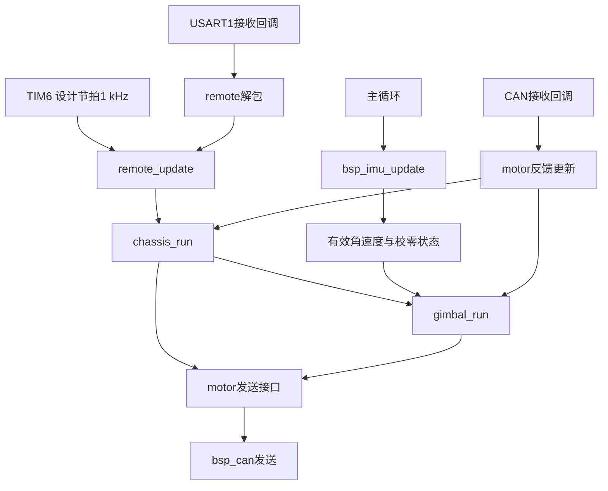

# NEW-INFANTRY-A · 步兵底盘与云台固件

> 西北农林科技大学 RoboMaster 猎隼战队 · 电控组
> 最后更新：2026-10-29

基于 DJI A 板（STM32F427IIH6）的步兵下位机固件。当前使用裸机主循环和 TIM6 1 kHz 控制节拍，主要业务是遥控驾驶、底盘跟随与小陀螺、YAW 控制、PITCH 水平保持。当前控制链未使用 RTOS 或 DMA 采集。

车辆已具备基本驾驶与云台控制功能，现阶段以代码阅读、可读性整理和专项验收为主。本文描述已提交主线中的设计；已有功能不等于所有机械工况都已验收。

## 一、功能与操作方式

| 功能 | 当前行为 |
|---|---|
| 云台参考系驾驶 | 左杆前进沿枪口指向移动，再按 YAW 相对角转换成底盘四轮目标 |
| 底盘跟随 | 关闭小陀螺时，车头自动向枪口方向收敛 |
| 小陀螺 | `sw2` 中位开启固定自转；轮速预算不足时优先保留旋转目标，缩小平移 |
| YAW 正常控制 | IMU 积分角外环、投影角速度内环，支持摇杆速度前馈 |
| YAW 启动回正 | 获准控制后寻找编码器零位 `5500`，带连续到位判断和超时接管 |
| IMU 三轴校零 | 上电静止采集 X/Y/Z 偏置，逐轴扣除后再做重力方向投影 |
| 闲置驻车 | 四轴回中且小陀螺关闭满 3 秒，底盘零轮速制动；停稳后锁存 YAW 相对编码器角 |
| PITCH 水平保持 | 编码器位置闭环保持 `level=6000`；当前未接入右杆手动俯仰 |
| 诊断与许可 | 配置/数值检查、反馈年龄、两轴独立禁止原因及驻车故障状态 |

### 遥控映射

| 物理输入 | 原始通道/拨杆 | 用途 |
|---|---|---|
| 左杆纵向 | `ch3` | 底盘前后 |
| 左杆横向 | `ch2` | 底盘横移 |
| 右杆横向 | `ch0` | YAW，输入层已修正方向，左推向左转 |
| 右杆纵向 | `ch1` | 保留 PITCH 输入映射；当前也参与驻车活动判定 |
| `sw2` 中位 | 数值 `3` | 开启小陀螺 |

原始行程约为 `−660～+660`，死区为 `60`，由 [input.c](USER/application/input.c) 统一映射为 `−1～+1`。死区内明确返回零，业务层不需要重复增加归中阈值。

### 回正、驻车与失联

- 回正状态：`WAIT=0 → RUN=1 → DONE=2`；故障为 `FAULT=3`。`TIMEOUT` 故障可在右杆归中后手动接管，回到零位并稳定后才清除告警；能手动操作不等于已经 `DONE`。
- 回正目标与方向使用底盘同一份标定：`yaw_zero_ecd=5500`、`yaw_ecd_dir=+1`，表示枪口向底盘左侧转时编码器增加。
- 驻车状态：`DRIVE=0 → BRAKE=1 → HOLD=2`；故障为 `FAULT=3`。正常驻车使用零轮速闭环，不冻结上一拍电流命令。
- 驻车保持枪口相对车体的角度，不是锁定绝对航向。有效推杆或开启小陀螺会退出驻车；底盘先更新状态，云台随后执行。
- 遥控离线时，两轴停止主动控制并发送零命令，PITCH 可能失去承托。当前没有“关闭遥控仍继续自稳”的策略。

当前主业务没有接入完整发射系统、视觉自瞄、裁判系统功率管理或超级电容控制。

## 二、硬件与通信

| 项目 | 当前配置 |
|---|---|
| 主控 | DJI A 板，STM32F427IIH6，Cortex-M4 |
| 时钟 | HSE 12 MHz，系统主频 168 MHz |
| IMU | MPU6500，SPI5，陀螺 ±1000 dps、加计 ±8 g |
| 遥控 | DT7/DR16 DBUS，USART1，100000 baud，9 位字长含偶校验，1 停止位 |
| CAN1 / CAN2 | 1 Mbps |
| 调试输出 | UART8，115200，8N1 |
| 控制定时器 | TIM6：84 MHz / (83+1) / (999+1) = 1 kHz |
| 调试接口 | SWD，CMSIS-DAP / DAPLink |

| 执行器 | 总线 | 反馈 ID | 命令帧 / 槽位 |
|---|---|---|---|
| 底盘 FR / FL / RL / RR | CAN1 | `0x201～0x204` | `0x200` / 0～3 |
| YAW GM6020 | CAN1 | `0x205` | `0x1FF` / 0 |
| PITCH，当前按 6623 格式处理 | CAN2 | `0x206` | `0x1FF` / 1 |

设备配置、反馈解包和发送边界集中在 [motor.c](USER/device/motor/motor.c)。PITCH 专用反馈解析没有提供实际速度，代码中的 `speed_rpm=0` 不能视为静止测量。

## 三、执行顺序与目录

[main.c](Core/Src/main.c) 初始化 IMU、电机接收注册、CAN 和遥控后开启 TIM6。主循环更新 IMU，控制计算在定时回调中执行。



`remote_update → chassis_run → gimbal_run` 的顺序有业务意义：本拍的推杆先让底盘退出驻车，云台随后消费更新后的状态。

当前抢占优先级为 TIM6=4、USART1/UART8=5、CAN RX=6。CAN 不能在 TIM6 回调中抢占，但 TIM6 可以打断尚未写完反馈的接收处理；多字段反馈仍不是严格的原子快照。1 kHz 是设计节拍，不是本次重新测得的最坏执行时间保证。

```text
Core/                         CubeMX入口、外设与中断
USER/
  application/
    input.c/.h                通道映射、死区、归一化
    chassis/chassis.c/.h      驾驶、跟随、自转分配、驻车与轮速闭环
    gimbal/gimbal.c/.h        启动回正、正常YAW、驻车保持、PITCH控制
  controller/pid.c/.h         PID计算
  device/
    motor/                    电机实例、反馈解析、组帧发送
    imu/                      MPU6500读取、三轴校零与投影
    remote/                   DBUS接收与在线判定
    buzzer/                   蜂鸣器
  bsp/
    can/                      CAN注册、接收分派与发送
    uart/                     调试串口
```

应用层调用控制算法和设备接口；电机协议由设备层处理，CAN 收发由 BSP 完成。当前采用同文件 `static` 函数划分职责，没有额外引入公共保护框架。

### 云台控制入口

```text
gimbal_run
  → gimbal_read_feedback       读取本拍原有反馈局部量
  → gimbal_update_measurement  编码器累计、IMU积分与角度低通
  → gimbal_check_permission    分别累计YAW/PITCH禁止原因
  → gimbal_yaw_run             回正/正常/驻车控制与异常处理、发送
  → gimbal_pitch_run           PITCH控制、复位与发送
```

自动回正：`编码器最短角差 → 回正角度P → 目标角速度 → IMU速度P → 命令限幅`。

正常位控：`摇杆积分目标角 → IMU角差外环 + 速度前馈 → IMU速度内环 → 输出`。

IMU 测量先逐轴扣除偏置，再沿估计重力方向投影。积分角会受残余零偏影响，并非无漂移的绝对航向；驻车主要隔离这种漂移对停车的影响。

## 四、参数与观察入口

| 配置入口 | 常用默认值 | 单位/意义 |
|---|---|---|
| `chassis_cfg.yaw_zero_ecd / yaw_ecd_dir` | `5500 / +1` | 本车零位与方向标定 |
| `chassis_cfg.max_rpm` | `5000` | 平移输入尺度及单轮目标上限，电机转子rpm |
| `chassis_cfg.spin_fixed_rpm` | `2000` | 四轮分配中的旋转分量，不是车身转速 |
| `chassis_cfg.follow_kp / follow_max_rpm` | `3000 / 2000` | 跟随增益与上限，死区3° |
| `chassis_cfg.kp / ki / kd` | `15 / 0 / 0` | 四轮轮速环 |
| `chassis_cfg.park` | `3000ms / 10rpm / 200ms / 3000ms` | 闲置时间、停稳阈值、稳定时间、制动超时 |
| `gimbal_cfg.yaw.kp_w / kp_ang` | `5000 / 5` | 正常速度P / 角度P |
| `gimbal_cfg.yaw.tgt_rate / speed_max` | `0.0038 / 4` | rad/tick / rad/s；当前两者并非同一速度尺度 |
| `gimbal_cfg.yaw.out_lim` | `20000` | YAW正常命令上限 |
| `gimbal_cfg.yaw.home` | `2.5rad/s / 8000 / 8000ms` | 回正速度上限、命令上限、超时 |
| `gimbal_cfg.yaw.park` | `kp=5 / 0.5rad/s / 3000` | 驻车位置增益、速度/命令上限 |
| `gimbal_cfg.pitch` | `level=6000 / dir=-1` | 水平基准及输出方向 |

- `cfg` 保存配置，`state` 保存运行状态；旧笔记中的独立变量名需对照当前 `.h` 文件。
- 底盘观察：`chassis_state.mode`、`yaw_rel_rad`、`park_state`、`park_fault`、`pid_tar[]`、`pid_fb[]`、`translation_scale`、`wz_applied`，均为 `chassis_state` 成员。
- 云台观察：`gimbal_state.home_state`、`home_fault`、`home_manual_ready`、`yaw_inhibit`、`pitch_inhibit`、`yaw_park_active`，均为 `gimbal_state` 成员；控制量另看 `yaw_tgt`、`yaw_err`、`yaw_omega_ref`、`yaw_out`。
- IMU看 `imu_online`、`imu_cal_source`、三轴偏置与原始gyro/acc。`imu_cal_source=1`使用本次三轴结果，`2`使用历史标量兜底；流程完成不保证本次三轴结果被采用。
- 同步记录 `remote.ch0～ch3`、拨杆、在线状态和时间，才能把响应与操作对应起来。

编码器一圈8192格；云台角度/速度主要使用rad、rad/s。发送命令不是安培；底盘旋转分量也不能直接当作车身rad/s。

## 五、构建与调试

主工具链为 CMake、Ninja、GNU Arm Embedded、OpenOCD 和 VS Code Cortex-Debug。命令行需能找到 `cmake`、`ninja`、`arm-none-eabi-gcc` 等程序；编辑器任务中的路径是本机配置，换电脑需核对。

在工程根目录执行：

```powershell
cmake --preset Debug
cmake --build --preset Debug

cmake --preset Release
cmake --build --preset Release
```

产物分别为 `build/Debug/firmware.elf`、`build/Release/firmware.elf`。预设见 [CMakePresets.json](CMakePresets.json)，芯片参数和链接脚本由预设传给工具链。

[CMakeLists.txt](CMakeLists.txt) 自动收集 `USER` 下的 `.c`，并加入含源文件目录的头文件路径；新增或移动文件后仍应核对实际编译清单。

VS Code 当前入口见 [.vscode/tasks.json](.vscode/tasks.json) 和 [.vscode/launch.json](.vscode/launch.json)：

- 构建任务：`构建`、`构建 (Release)`。
- 烧录任务：`烧录 (Debug)`，带构建/烧录前自检依赖。
- 调试配置：`调试 Debug (DAPLink + OpenOCD)`、`调试 Release (DAPLink + OpenOCD)`。

编译通过只表示该次源码编译链接完成；烧录需以实际program/verify/reset结果为准。板上版本一致性、机械行为和控制耗时应分别验证。

`MDK-ARM/` 是保留的历史工程，清单存在旧目录引用；当前主路径为 CMake/GNU Arm，近期验证不代表 Keil 已通过。

## 六、验证记录与已知边界

### 最近一次结构整理：2026-10-29，基线至9e40f48

- 应用307个场景完成：290通过，17个已有失败保持不变，478442次断言。不能表述为307项全部通过。
- 逐步对照重构前后的用例输出和发送序列状态摘要，没有新增差异；异常参数场景只表征现状，不证明其行为合理。
- IMU离线测试150/150，覆盖默认、YAW反号、诊断Z反号三种配置。
- Debug/Release完整编译链接，最终构建日志中无编译警告/错误。上述验证对应当时源码快照，不自动覆盖后续本地编辑。
- 此轮没有烧录，没有测量实际中断耗时或补做机械系统验收。

### 后续需要单独处理

1. **非法限幅参数**：`home/park.out_lim`、`w_ref_lim`等基本前提未完整校验。离线已复现负限幅制造非零命令；默认值为正，不代表可任意写入Watch值。校验应集中在现有配置检查函数。
2. **测量发布一致性**：反馈多字段可能在发布中途被控制中断读取，IMU有效数据年龄与发布约定仍可完善。
3. **诊断与注释**：回正CONFIG故障不一定映射到inhibit的CONFIG位；部分旧注释与当前表达式不一致，阅读时以实际调用和单位为准。
4. **专项实车验收**：完整回正时间线、驻车进入/退出与不同负载工况仍需留有对应数据。
5. **手感与目标尺度**：当前目标积分速率为3.8rad/s，前馈尺度4rad/s；跟随死区边缘和加速度约束可根据实测症状单独优化。
6. **故障策略**：普通驾驶单轮超时只停该轮，驻车阶段则检查四轮并可能整车停输出；二者不是同一恢复流程。

旧README中的10月14日温漂、静摩擦阈值、固定频率和体积数据属于历史调试条件，不再作为当前版本性能结论。

## 七、推荐阅读路线

按“一次推杆如何变成电机动作”阅读：

| 顺序 | 入口 | 应弄清的问题 |
|---|---|---|
| 1 | [main.c](Core/Src/main.c) | 初始化、主循环、TIM6分别负责什么 |
| 2 | [motor.h](USER/device/motor/motor.h)、[motor.c](USER/device/motor/motor.c) | 配置、实例、反馈、命令如何组织 |
| 3 | [remote.c](USER/device/remote/remote.c)、[input.c](USER/application/input.c) | 一次推杆如何从字节变成归一化意图 |
| 4 | [pid.c](USER/controller/pid.c) | 目标、反馈、误差、输出和限幅如何关联 |
| 5 | [chassis.c](USER/application/chassis/chassis.c) | 许可与驻车→坐标转换→转向选择→四轮分配→轮速PID |
| 6 | [gimbal.c](USER/application/gimbal/gimbal.c) | 回正、正常控制、驻车分别使用什么反馈，如何接管 |
| 7 | [bsp_imu.c](USER/device/imu/bsp_imu.c) | 标度、三轴偏置、重力投影与在线状态如何产生 |
| 8 | [bsp_can.c](USER/bsp/can/bsp_can.c) | 接收注册、分派和发送怎样闭合链路 |

每次围绕一个函数确认：用途、调用者、输入输出、单位、执行顺序、状态变化和恢复条件。

## 八、协作与资料约定

- 协作规范见 [AGENTS.md](AGENTS.md)。修改前明确范围，控制调整与结构整理分步进行。
- 保留现有风格：配置表、实例反馈、统一发送，以及应用层明确的run入口。优先用职责清楚的同文件短函数组织细节。
- 不提交构建产物、采样日志和机器相关桥接文件，规则见 [.gitignore](.gitignore)。
- 维护者本机的新文档、备份、测试副本、构建和日志统一保存到 `C:\Users\fan\Desktop\MarkDown\MdByCodex`；它们不随克隆仓库自动获得。
- 最近资料：`20261029-控制代码可读性重构/完成交付.md`、`20261029-分析-DeepSeek云台审阅逐项复核.md`，均位于上述本机目录，包含原始命令、时间戳、结果与源码哈希。
- 本地参考包括ARBATOS、中科大RMPPT和湖南大学框架；采用其思路前需核对硬件、单位、调用链及实际需求。
